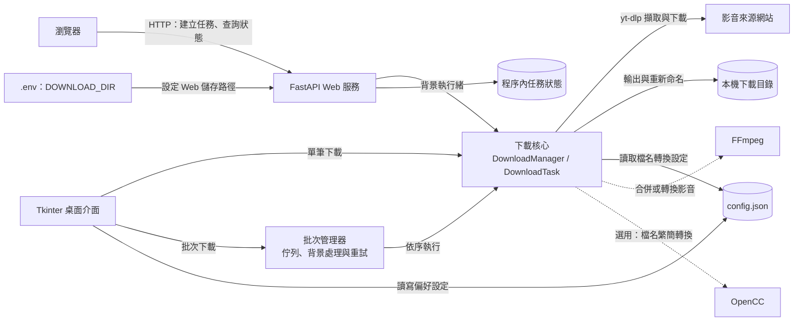

# 影片下載器 v2.0

優化版影片下載器，支援 YouTube、Bilibili 等多平台影片/音訊下載。

## 📋 主要特色

- ✅ **模組化架構**: 清晰的關注點分離，易於維護與擴展
- ✅ **批次下載**: 支援多個 URL 依序下載，自動重試機制
- ✅ **進度追蹤**: 即時顯示下載進度、速度、剩餘時間
- ✅ **取消功能**: 可隨時中止進行中的下載
- ✅ **格式選擇**: 支援多種影片解析度與音訊品質
- ✅ **繁簡轉換**: 自動將簡體檔名轉為繁體中文
- ✅ **錯誤處理**: 完善的錯誤處理與日誌記錄
- ✅ **設定儲存**: 保存使用者偏好設定
- ✅ **跨平台支援**: Windows、macOS、Linux
- 🕸️ **Web 版介面 (Bootstrap 5)**: 不開桌面 UI 也可透過瀏覽器下載

## 📦 安裝

### 環境需求
- Python 3.11+（新版 yt-dlp 的最低需求）
- FFmpeg（合併分離的影音串流、音訊轉換必須）
- Deno 2.3.0+，且 `deno` 必須位於啟動程式的 `PATH` 中（YouTube JavaScript 驗證需要）

### 安裝步驟

1. 克隆或下載專案
```bash
git clone <repository_url>
cd video-downloader
```

2. 安裝 Python 套件
```bash
python -m pip install --upgrade -r requirements.txt
```

請使用啟動本專案的同一個 Python 環境執行安裝。`yt-dlp[default]` 會一併安裝版本相容的 `yt-dlp-ejs`，供 YouTube JavaScript 驗證使用。

3. （選擇性）設定下載目錄

在專案根目錄建立 `.env`，指定 Web 版下載儲存路徑（預設為 `./downloads`）
```bash
DOWNLOAD_DIR=/absolute/path/to/downloads
```

4. 安裝 FFmpeg

**Windows:**
```bash
# 使用 Chocolatey
choco install ffmpeg

# 或從官網下載: https://ffmpeg.org/download.html
```

**macOS:**
```bash
brew install ffmpeg
```

**Linux (Ubuntu/Debian):**
```bash
sudo apt update
sudo apt install ffmpeg
```

5. 安裝 Deno

macOS 可使用：
```bash
brew install deno
deno --version
```

Windows / Linux 請參考 [Deno 官方安裝說明](https://docs.deno.com/runtime/getting_started/installation/)。安裝後重新啟動終端機或 IDE，確認啟動下載器的環境可以執行 `deno --version`。yt-dlp 預設會啟用 Deno，詳見 [官方 EJS 設定指南](https://github.com/yt-dlp/yt-dlp/wiki/EJS)。

## 🚀 使用方法

### 啟動程式
```bash
python main.py
```

### 啟動 Web 版介面（Bootstrap 5）
```bash
uvicorn src.web.app:app --host 0.0.0.0 --port 8000
# 或
python -m src.web.app
```

- 開啟瀏覽器訪問 `http://127.0.0.1:8000`
- 下載路徑會依 `.env` 的 `DOWNLOAD_DIR` 設定，自動建立目錄

### 基本操作

#### 單一下載
1. **輸入 URL**: 在 URL 欄位貼上影片連結
2. **選擇格式**: 
   - 影片品質: 最高畫質 / 1080p / 720p / 480p
   - 音訊品質: MP3 (192/320kbps) / M4A / OPUS
3. **設定路徑**: 選擇儲存位置（預設為 `./downloads`）
4. **開始下載**: 點擊「下載影片」或「下載音樂」
5. **取消下載**: 若需要，點擊「取消下載」按鈕

#### 批次下載
1. **切換模式**: 選擇「批次下載」選項
2. **輸入 URL 清單**: 在文字區域輸入多個 URL，使用逗號分隔
   ```
   https://www.youtube.com/watch?v=example1,
   https://www.youtube.com/watch?v=example2,
   https://www.bilibili.com/video/example3
   ```
3. **選擇格式**: 所有 URL 將使用相同的格式設定
4. **開始批次下載**: 點擊「下載影片」或「下載音樂」
5. **監控進度**: 查看批次進度和個別任務狀態
6. **自動重試**: 失敗的任務會自動重試最多 3 次
7. **管理佇列**: 使用「清除佇列」按鈕清空待下載清單

### 快捷鍵
- `Ctrl+V`: 貼上 URL
- `Enter`: 開始下載影片

## 🏗️ 系統架構



[開啟 Archify 互動式架構圖](.archify/architecture-video-downloader-20261106-211353/video-downloader.html)（下載專案後以瀏覽器開啟 HTML）。互動圖依已提交版本 `bfe9997` 繪製；目前工作目錄的 Web 介面可能與該版本不同。

- **資料流程**：Web 版以 `POST /api/download` 建立任務，再以 `GET /api/status/{task_id}` 查詢狀態；桌面版支援單筆及批次下載，批次任務依序處理並在失敗時重試。
- **儲存方式**：Web 任務狀態保存在程序記憶體，服務重啟後不保留，亦不會在多個程序之間共享。影音檔案寫入本機下載目錄；桌面偏好設定使用 `config.json`。
- **部署與安全**：上述啟動範例監聽 `0.0.0.0`，目前應用程式未提供登入或授權機制。若要開放網路存取，需先確認部署環境、存取控制與網路隔離方式。

## 📁 專案結構

```
video-downloader/
├── main.py              # 程式入口
├── src/
│   ├── core/
│   │   ├── downloader.py        # 單一下載核心
│   │   ├── batch_downloader.py  # 批次下載管理
│   │   ├── config.py            # 設定管理
│   │   └── constants.py         # 常數定義
│   ├── ui/
│   │   └── main_window.py       # 主視窗介面
│   ├── web/                     # FastAPI、網頁範本與靜態資源
│   └── utils/                   # 工具模組
├── test_batch.py        # 批次下載測試
├── requirements.txt     # 套件需求
├── config.json          # 使用者設定（自動生成）
├── downloader.log       # 日誌檔案（自動生成）
└── downloads/           # 預設下載目錄（自動生成）
```

## ⚙️ 設定選項

點擊「設定」按鈕可調整以下選項：

- **自動轉換檔名**: 將簡體中文檔名轉為繁體
- **自動開啟目錄**: 下載完成後自動開啟儲存目錄

設定會自動儲存至 `config.json`。

## 🔧 進階使用

### 自訂下載選項

編輯 `constants.py` 以自訂：
- 影片格式選項
- 音訊品質設定
- 下載逾時時間
- 重試次數
- UI 主題顏色

### 日誌檔案

所有操作都會記錄在 `downloader.log`，包含：
- 下載開始/完成時間
- 錯誤訊息詳情
- 檔名轉換記錄

## 🐛 常見問題

### Q: YouTube 出現 SABR 警告或 `HTTP Error 403: Forbidden`
**A**: SABR 警告表示部分客戶端取得的格式缺少直接下載 URL，不一定會導致整個下載失敗；403 則表示影音串流請求被 YouTube 拒絕。過舊的 yt-dlp 或缺少 JavaScript 驗證元件都可能造成可用格式減少或下載失敗。

先在執行本專案的 Python 環境更新 yt-dlp 與配套依賴，並確認 Deno 可用：
```bash
python -m pip install --upgrade "yt-dlp[default]"
deno --version
```

更新後須停止並重新啟動 Web 服務或桌面程式，讓執行中的程序載入新版本。`GET /api/status/...` 回傳 `200 OK` 只代表任務狀態查詢成功；下載結果請查看回傳內容的 `status` 與 `message`。

若仍失敗，請保留完整的 yt-dlp 警告與錯誤，確認是否另有登入、地區、IP 或 PO Token 限制；僅憑 403 無法判定是哪一種原因。新版問題可依 [yt-dlp 官方更新指引](https://github.com/yt-dlp/yt-dlp#update)評估 nightly 版本。

### Q: 下載失敗顯示「FFmpeg 未安裝」
**A**: 請依照安裝步驟安裝 FFmpeg。音訊轉換功能需要 FFmpeg 支援。

### Q: 檔名沒有轉換為繁體中文
**A**: 確認已安裝 `opencc-python-reimplemented` 套件，並在設定中啟用「自動轉換檔名」。

### Q: 下載速度很慢
**A**: 這通常與網路狀態或影片平台限制有關。可以嘗試：
- 檢查網路連線
- 選擇較低解析度
- 使用代理伺服器（未來版本支援）

### Q: 批次下載時部分任務失敗怎麼辦？
**A**: 系統會自動重試失敗的任務最多 3 次。重試期間會保留原始檔名轉換設定。最終失敗的任務會在日誌中標記，成功的任務不受影響。

### Q: 如何準備批次下載清單？
**A**: 將多個 URL 用逗號分隔，可以跨行輸入：
```
https://example1.com,
https://example2.com,
https://example3.com
```
或使用「載入批次清單」按鈕從剪貼簿貼上。

**從播放清單產生批次清單**：使用 yt-dlp 指令取得播放清單中所有影片的 URL
```bash
yt-dlp --flat-playlist --print "https://www.youtube.com/watch?v=%(id)s," "播放清單URL"
```
範例：
```bash
yt-dlp --flat-playlist --print "https://www.youtube.com/watch?v=%(id)s," "https://www.youtube.com/playlist?list=PLBakWosU0sfjzq5MHaM7L_y7RzT6tGfps"
```

### Q: 支援哪些平台？
**A**: 支援所有 yt-dlp 支援的平台，包括但不限於：
- YouTube
- Bilibili
- Twitter/X
- Facebook
- Instagram
- TikTok
- 完整清單: https://github.com/yt-dlp/yt-dlp/blob/master/supportedsites.md

## 📝 更新日誌

### v2.1.0 (2025-01-XX)
- ✨ 新增批次下載功能
- ✨ 新增自動重試機制（最多 3 次）
- ✨ 新增批次進度顯示
- ✨ 新增批次佇列管理
- ✨ 保留檔名繁簡轉換功能
- 🐛 修復多任務同時執行的問題
- 🐛 改進錯誤處理和日誌記錄

### v2.0.0 (2025-10-01)
- ✨ 完全重構，模組化架構
- ✨ 新增取消下載功能
- ✨ 新增即時進度顯示
- ✨ 新增格式選擇功能
- ✨ 新增設定管理
- ✨ 改進錯誤處理
- ✨ 改進 UI/UX
- ✨ 新增日誌系統
- ✨ 新增跨平台支援

### v1.0.0
- 🎉 初始版本

## 🤝 貢獻

歡迎提交 Issue 或 Pull Request！

## 📄 授權

MIT License

## 👨‍💻 作者

Ned Lin

## 🙏 致謝

- [yt-dlp](https://github.com/yt-dlp/yt-dlp) - 強大的影片下載工具
- [OpenCC](https://github.com/BYVoid/OpenCC) - 繁簡轉換引擎
- [FFmpeg](https://ffmpeg.org/) - 多媒體處理框架
