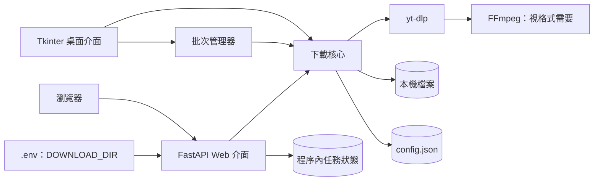

# 專案架構說明

本專案提供 Tkinter 桌面介面與 FastAPI Web 介面，兩者共用 yt-dlp 下載核心。桌面介面另透過批次管理器依序處理清單。

- `src/core/downloader.py`：單筆下載、進度、取消及輸出檔名處理。
- `src/core/batch_downloader.py`：桌面批次佇列、重試與取消。
- `src/core/config.py`：桌面偏好及下載核心的檔名轉換設定。
- `src/ui/`：桌面介面；`src/web/`：Web 服務、範本與靜態資源。
- `src/utils/`：輸入驗證、檔案、系統與日誌工具。
- `main.py`、`src/main.py`：桌面入口；`src/web/app.py`：Web 入口。

Web 任務狀態儲存在程序記憶體，重新啟動後不保留；Web 預設僅監聽本機。下載檔案寫入本機目錄，Web 目錄可使用 `.env` 的 `DOWNLOAD_DIR` 設定。桌面設定儲存在目前工作目錄的 `config.json`。

Web 目前不提供帳號、遠端檔案下載或跨程序任務同步。平台支援取決於 yt-dlp 與來源網站；新增站點不一定需要修改本專案程式碼。
